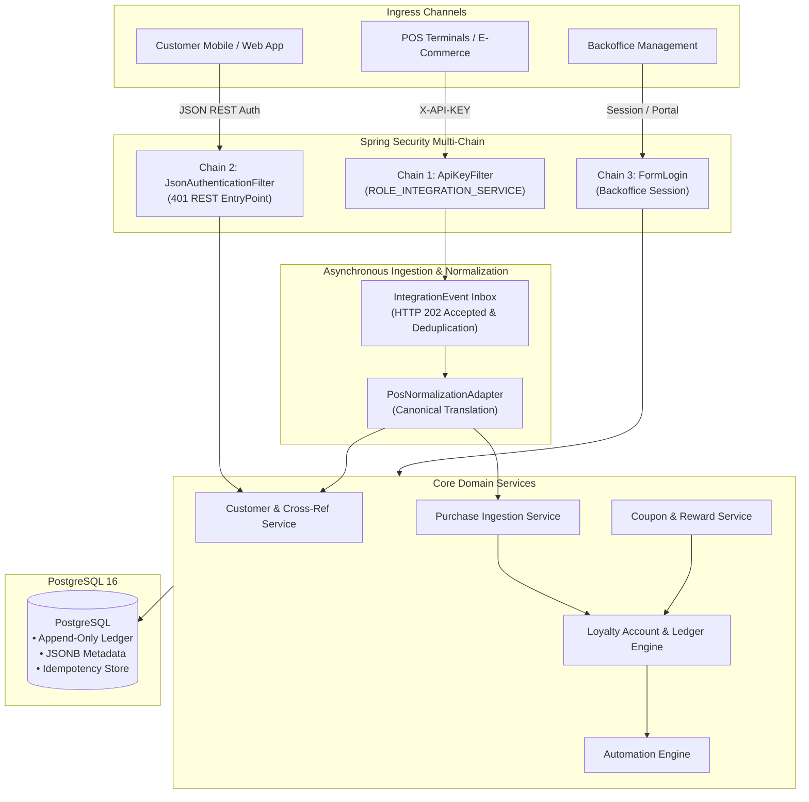

<!-- prettier-ignore -->
<div align="center">


# Loyalty Engine

*High-throughput, multi-tenant loyalty and rewards platform for modern retail and POS ecosystems.*

[](https://openjdk.org)
[](https://spring.io/projects/spring-boot)
[](https://www.postgresql.org)
[](http://localhost:8080/swagger-ui.html)
[](#architecture)
[](#getting-started)

⭐ If you find this project useful, give it a star on GitHub!

[Overview](#overview) • [Key Features](#key-features) • [Architecture](#architecture) • [Getting Started](#getting-started) • [Usage Guide](#usage-guide) • [Project Structure](#project-structure) • [Documentation](#documentation)

</div>

---

## Overview

**Loyalty Engine** is an enterprise-grade backend service built to power omni-channel customer loyalty programs, real-time point accruals, and cash-desk reward redemptions.

Retail point-of-sale systems are notoriously fragmented. **Loyalty Engine** decouples POS vendors via canonical normalization adapters, absorbs high-volume retail traffic through an asynchronous event inbox, and guarantees zero accounting drift with an append-only, mathematically auditable double-entry point ledger.

> [!NOTE]
> **POS-Agnostic Architecture**<br>
> Upstream POS vendors (such as Kioskito, custom terminals, or e-commerce checkouts) communicate through standardized HTTP payloads. Internal adapters map vendor formats into canonical domain contracts without modifying the underlying loyalty business logic.

---

## Key Features

- **Decoupled POS Integration**: Pluggable `PosNormalizationAdapter` layer translates disparate vendor payloads into unified internal domain commands.
- **Reliable Event Inbox & Idempotency**: High-velocity event ingestion endpoint returns `HTTP 202 Accepted` within 500 ms, buffering events with strict idempotency keys to eliminate duplicate processing under flaky network conditions.
- **Immutable Point Ledger**: Financial-grade, append-only transactions (`EARN`, `REDEEM`, `REVERSAL`, `EXPIRATION`) enforcing a strict zero-balance floor to prevent negative point balances.
- **Dynamic Customer Tiering**: Tier evaluation engines support customizable threshold levels (Bronze, Silver, Gold, Platinum) with point multipliers and special benefits.
- **Real-Time Coupon Validation & Burn**: POS cashiers can validate coupon codes and execute atomic redemptions in milliseconds during active checkout.
- **Lifecycle Automations**: Reactive event-driven workflow engine triggers actions based on customer habits, such as generating promotional coupons or sending retention notifications.
- **Three-Tier Security Filter Chains**: Spring Security 6 multi-chain architecture isolating M2M POS integration traffic (API Key), client application REST traffic (JSON session auth), and administrative backoffice web portals.
- **Zero-Boilerplate Standards**: Java 17 records with declarative Jakarta validation annotations for all DTOs and rich JPA domain entities with encapsulated state transitions.

---

## Architecture

The system uses a modular, hexagonal architecture that isolates ingress channels, core domain logic, and external persistence adapters.



> [!IMPORTANT]
> **REST Security Contract**<br>
> All unauthenticated or unauthorized access attempts to `/api/**` return semantic `HTTP 401 Unauthorized` JSON responses (`ApiErrorResponse`), completely eliminating HTML 302 redirect loops in automated REST consumers.

---

## Getting Started

### Prerequisites

- **Java 17** or higher
- **Maven 3.8+**
- **Docker** (for local PostgreSQL instance)

### 1. Launch the Database

Start a local PostgreSQL 16 instance with the required configuration:

```bash
docker run --name loyalty-postgres \
  -e POSTGRES_DB=loyalty_engine \
  -e POSTGRES_USER=postgres \
  -e POSTGRES_PASSWORD=postgres \
  -p 5432:5432 -d postgres:16-alpine
```

### 2. Build the Application

Clone the repository and compile using the Maven wrapper:

```bash
mvn clean package -DskipTests
```

### 3. Run the Service

Execute the Spring Boot executable:

```bash
mvn spring-boot:run
```

The service will boot on `http://localhost:8080`.

> [!TIP]
> **In-Memory Testing**<br>
> You can run the entire integration test suite using the embedded H2 profile with `mvn test`.

---

## Usage Guide

### 1. Ingesting POS Purchase Events

Send a sales event with raw vendor payload. The endpoint deduplicates the event, acknowledges immediately, and queues processing in the background:

```bash
curl -i -X POST http://localhost:8080/api/v1/events \
  -H "Content-Type: application/json" \
  -H "X-API-KEY: test-kioskito-api-key" \
  -d '{
    "type": "purchase.completed",
    "eventId": "evt-pos-10029",
    "occurredAt": "2026-11-21T15:30:00Z",
    "data": {
      "purchaseId": "ticket-9842",
      "customerId": "pos-cust-4821",
      "total": 35000.00,
      "currency": "ARS",
      "customer": {
        "name": "Maria Gonzalez",
        "email": "maria.gonzalez@example.com",
        "phone": "+5491144443333",
        "birthDate": "1992-08-20"
      }
    }
  }'
```

**Expected Response (`HTTP 202 Accepted`):**

```json
{
  "inboxId": "d3b07384-d113-494b-9c8e-671239840212",
  "status": "ACCEPTED",
  "message": "Event accepted for processing"
}
```

### 2. Querying Customer Balance & Ledger

Retrieve the customer's active point balance, current tier, and program metadata:

```bash
curl -X GET http://localhost:8080/api/v1/customers/d3b07384-d113-494b-9c8e-671239840212/loyalty
```

**Expected Response (`HTTP 200 OK`):**

```json
{
  "accountId": "7b5212ec-3f2d-4191-8f55-14902b740578",
  "currentBalance": 350,
  "tier": "Silver",
  "activeProgram": "Default Retail Points",
  "updatedAt": "2026-11-21T15:30:02Z"
}
```

### 3. Validating & Redeeming a Coupon at POS

Cashier terminals validate coupon eligibility before applying discounts:

```bash
# Validate coupon status
curl -X POST http://localhost:8080/api/v1/coupons/validate \
  -H "Content-Type: application/json" \
  -H "X-API-KEY: test-kioskito-api-key" \
  -d '{"code": "SUMMER-15-OFF"}'
```

```bash
# Execute coupon redemption (burn code)
curl -X POST http://localhost:8080/api/v1/coupons/redeem \
  -H "Content-Type: application/json" \
  -H "X-API-KEY: test-kioskito-api-key" \
  -d '{
    "code": "SUMMER-15-OFF",
    "purchaseId": "ticket-9842"
  }'
```

---

## Project Structure

```
src/main/java/com/loyalty/
├── automation/           # Rule engine triggers, scheduled actions, and customer lifecycle tasks
├── coupon/               # Coupon lifecycle, discount verification, and atomic checkout burn
├── customer/             # Customer identity, cross-reference mapping, and aggregate statistics
├── integration/          # Asynchronous inbox, POS normalization adapters, and M2M controllers
├── loyalty/              # Core account aggregate, tier management, and immutable point ledger
├── notification/         # Provider adapters for dispatching email and WhatsApp alerts
├── purchase/             # Normalized purchase aggregate and historical sales storage
├── reward/               # Rewards catalog, eligibility evaluation, and redemption claims
├── shared/               # Multi-chain security, exception handlers, and OpenPDF report generation
└── tenant/               # Multi-tenant scoping and store configuration
```

---

## Documentation

- **Swagger UI Interactive Explorer**: Available at `http://localhost:8080/swagger-ui.html` once the application is running.
- **OpenAPI 3 JSON Specification**: Available at `http://localhost:8080/v3/api-docs`.
- **Contribution & Extension Guide**: Learn about coding standards, environment setup, and how to implement custom POS adapters in [CONTRIBUTING.md](CONTRIBUTING.md).
- **System Architecture & Domain Guides**: Comprehensive guides are located in the [`docs/`](docs/) directory and viewable via MkDocs:
  ```bash
  mkdocs serve
  ```
