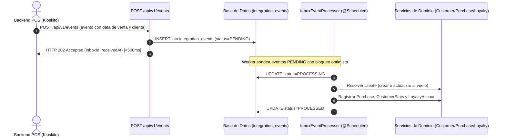

# Bandeja de Entrada de Eventos (Event Inbox) e Idempotencia

Para asegurar que las ventas en caja se procesen de forma confiable sin degradar los tiempos de respuesta del backend del POS, el sistema implementa una **Cola de Eventos Interna (Transactional Event Inbox)**.

---

## Flujo de Ingesta Asíncrona



---

## Garantía de Idempotencia en Dos Niveles

Los sistemas de backend frecuentemente reintentan envíos por micro-cortes de conexión o timeouts de red. El sistema garantiza exactamente-un-efecto en dos niveles:

### Nivel 1: Nivel de Ingesta (`IntegrationEvent`)
- Restricción única en base de datos:
  ```sql
  UNIQUE (integration_id, external_event_id)
  ```
- Si el backend del POS reenvía el mismo `eventId` para la misma conexión, el endpoint detecta el duplicado de inmediato, responde con el estado ya existente y evita duplicar la fila de evento.

### Nivel 2: Nivel de Dominio (`Purchase` y `PointTransaction`)
- Restricción única de compra:
  ```sql
  UNIQUE (integration_id, external_id)
  ```
- Restricción única de movimiento de puntos:
  ```sql
  UNIQUE (account_id, idempotency_key)
  ```
- Si por cualquier motivo un evento se re-procesara en el worker, las operaciones contra el libro mayor y la tabla de compras fallan limpiamente sin duplicar la acreditación de puntos.

---

## Estados del Evento

| Estado | Significado | Próxima Acción |
|---|---|---|
| `PENDING` | Evento recibido y encolado en la bandeja. | Será tomado por el próximo lote del worker. |
| `PROCESSING` | En ejecución por un hilo de procesamiento. | Bloqueado temporalmente para evitar ejecuciones concurrentes. |
| `PROCESSED` | Normalizado y despachado con éxito a las entidades de dominio. | Estado final auditado. |
| `FAILED` | Error no recuperable o reintentos agotados. | Registra mensaje de error para análisis y alerta de soporte. |
