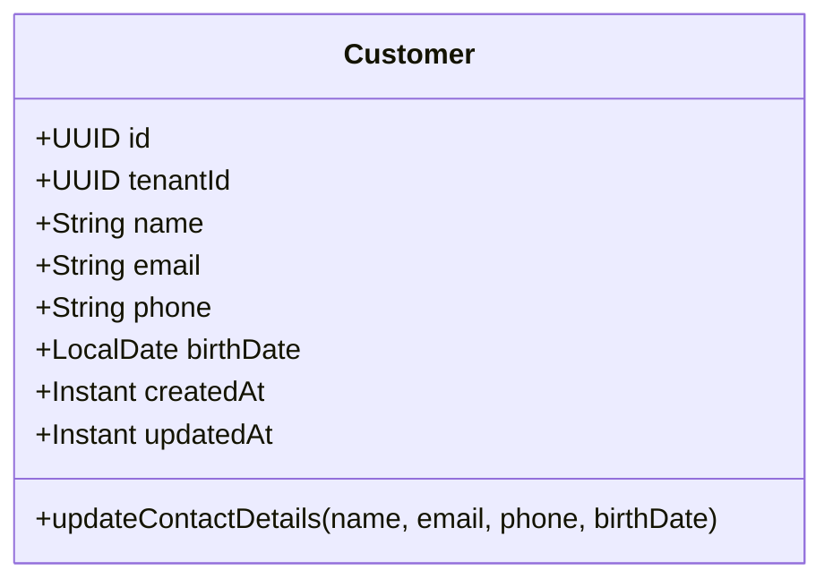
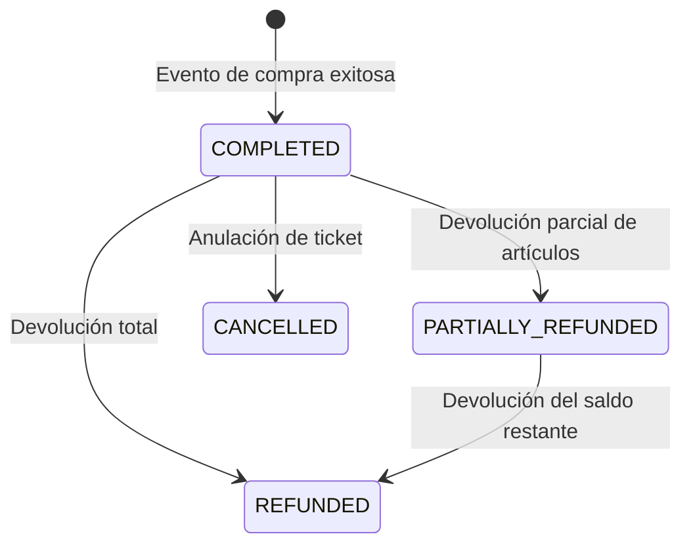

# Clientes, Compras y Proyecciones Estadísticas

Gestiona la identidad del consumidor final, la ingesta inmutable de tickets de compra y el cálculo en tiempo real de su comportamiento comercial.

---

## 1. Entidad: Customer

Perfil canónico del cliente. Es la raíz de agregación para cuentas de fidelización y cupones.

- **Restricción de unicidad**: `UNIQUE(tenant_id, email)` (cuando el email no es nulo).
- Los cambios de datos de contacto disparan un método de dominio explícito `updateContactDetails` que actualiza `updatedAt`.

---

## 2. Entidad: Purchase

Registro normalizado de las compras emitidas por el POS.

### Ciclo de Vida de una Compra

### Invariantes de Negocio
1. **Inmutabilidad**: Las compras no se eliminan físicamente para corregir errores. Se registran transiciones de estado explícitas.
2. **Idempotencia**: Restricción `UNIQUE(integration_id, external_id)`. El POS no puede insertar dos veces la misma venta.
3. **Monto y Moneda**: El monto total (`total`) se almacena como `NUMERIC(14,2)` y la moneda como código ISO de 3 caracteres (`ARS`, `USD`).

---

## 3. Entidad: CustomerStats

Proyección materializada que resume el comportamiento del cliente a partir de su historial de compras.

| Atributo | Tipo | Descripción |
|---|---|---|
| `customerId` | `UUID` (PK, FK) | Identificador del cliente. |
| `totalPurchases` | `Integer` | Cantidad total de compras completadas. |
| `totalSpent` | `BigDecimal` | Suma acumulada de importes netos comprados. |
| `averageTicket` | `BigDecimal` | Ticket promedio (`totalSpent / totalPurchases`). |
| `firstPurchaseAt` | `Instant` | Fecha y hora de la primera compra registrada. |
| `lastPurchaseAt` | `Instant` | Fecha y hora de la última compra registrada (base para regla de inactividad). |

### Actualización Atómica
Cada vez que una compra cambia de estado (completada, cancelada o devuelta), el servicio `CustomerStatsService` recalcula esta fila dentro de la misma transacción, garantizando que los triggers de automatización (ej. primera compra o umbral de gasto) cuenten con información fresca y exacta.
