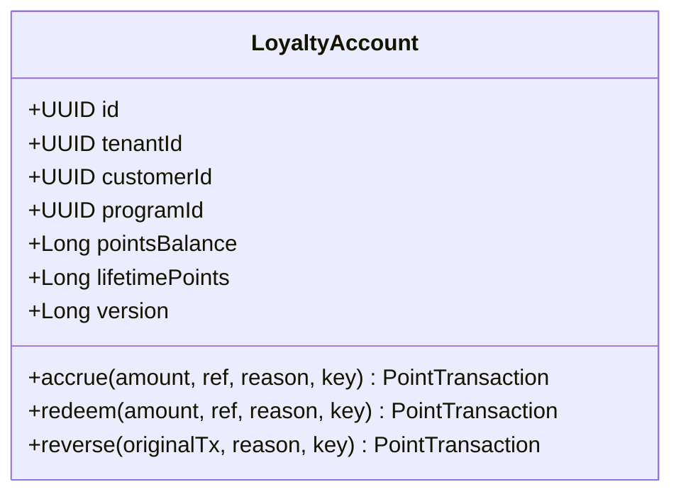

# Programas de Puntos y Libro Mayor (Ledger)

El corazón de Loyalty Engine reside en su motor de puntos: un sistema de libro mayor inmutable (append-only) que garantiza consistencia matemática total y previene saldos negativos.

---

## 1. Entidad: LoyaltyProgram

Define las reglas comerciales de acumulación y vencimiento configuradas por cada comercio.

- `type`: `POINTS` (MVP), `COUPONS`, `TIERS`.
- `configuration` (`JSONB`): Parámetros flexibles mapeados mediante `@JdbcTypeCode(SqlTypes.JSON)`:
  ```json
  {
    "pointsPerSpend": 100.0,
    "pointsAwarded": 1,
    "expirationMonths": 12,
    "minPurchaseAmount": 500.0
  }
  ```

---

## 2. Entidad: LoyaltyAccount (Aggregate Root)

Representa la cuenta de fidelización del cliente en un programa determinado.



- **Restricción de unicidad**: `UNIQUE(program_id, customer_id)`.
- **Restricción de integridad**: `CHECK (points_balance >= 0)`.
- **Control de concurrencia**: Columna `@Version private Long version` para asegurar que dos canjes concurrentes en caja no produzcan condiciones de carrera ni dejen el saldo negativo.

---

## 3. Entidad: PointTransaction (Libro Mayor Inmutable)

Cada alteración de puntos queda registrada de forma permanente en `point_transactions`.

```sql
CREATE TABLE point_transactions (
    id UUID PRIMARY KEY,
    account_id UUID NOT NULL REFERENCES loyalty_accounts(id),
    type VARCHAR(32) NOT NULL,
    amount BIGINT NOT NULL,
    reference_id UUID,
    idempotency_key VARCHAR(128) NOT NULL,
    description VARCHAR(255) NOT NULL,
    created_at TIMESTAMPTZ NOT NULL,
    CONSTRAINT uq_account_tx_key UNIQUE (account_id, idempotency_key)
);
```

### Tipos de Transacción

| Tipo | Signo del Monto | Disparador Habitual |
|---|---|---|
| `EARN` | Positivo (`+`) | Acreditación por compra finalizada en el POS. |
| `REDEEM` | Negativo (`-`) | Canje de puntos por un beneficio o cupón de descuento. |
| `EXPIRE` | Negativo (`-`) | Vencimiento de puntos por política temporal del programa. |
| `ADJUST` | Positivo o Negativo | Corrección manual autorizada por el administrador del comercio. |
| `REVERSAL` | Negativo (`-`) | Reversión compensatoria por compra cancelada o devuelta. |

### Reglas no negociables del Libro Mayor
1. **Los movimientos nunca se modifican ni se eliminan**: Una corrección o anulación genera una nueva fila compensatoria (`REVERSAL`).
2. **Reversión con saldo insuficiente**: Si el cliente ya canjeó sus puntos y luego devuelve la mercadería comprada, la reversión reduce los puntos hasta el piso de 0 y marca una alerta de auditoría.
