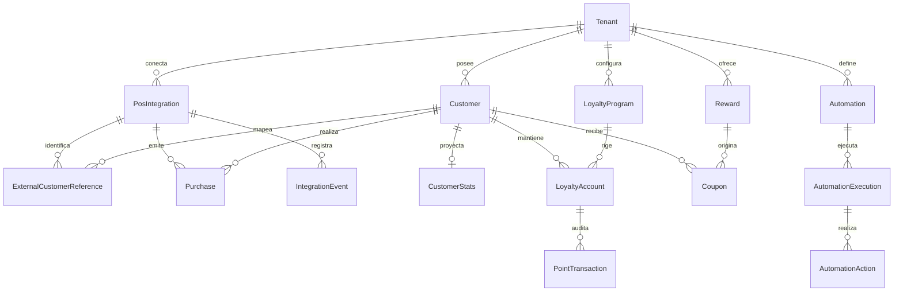

# Resumen del Modelo de Dominio

El modelo de datos de Loyalty Engine sigue un enfoque de **modelo rico y encapsulado** (DDD - Domain-Driven Design), persistido en PostgreSQL mediante JPA/Hibernate 6 y JSONB para reglas dinámicas.

---

## Diagrama Entidad-Relación

---

## Entidades Principales

| Entidad | Tabla | Responsabilidad Principal |
|---|---|---|
| **Tenant** | `tenants` | Comercio o empresa dueña de la cuenta de Loyalty Engine. |
| **PosIntegration** | `pos_integrations` | Credenciales y estado de conexión con un POS (ej. Kioskito). |
| **Customer** | `customers` | Perfil canónico unificado del cliente del comercio. |
| **ExternalCustomerReference** | `external_customer_references` | Mapeo entre el ID interno y el ID que maneja el POS. |
| **Purchase** | `purchases` | Registro inmutable de compras, devoluciones o cancelaciones. |
| **CustomerStats** | `customer_stats` | Proyección de métricas (ticket promedio, compras acumuladas). |
| **LoyaltyProgram** | `loyalty_programs` | Reglas de acumulación, vencimientos y factores de conversión en JSONB. |
| **LoyaltyAccount** | `loyalty_accounts` | Saldo actual y puntos históricos del cliente en un programa. |
| **PointTransaction** | `point_transactions` | Movimientos inmutables del libro mayor (`EARN`, `REDEEM`, `REVERSAL`). |
| **Reward** | `rewards` | Beneficios o productos canjeables del catálogo. |
| **Coupon** | `coupons` | Código de cupón unívoco de descuento asignado a un cliente. |
| **Automation** | `automations` | Definición de regla reactiva (trigger + condiciones + acciones). |
| **AutomationExecution** | `automation_executions` | Registro y trazabilidad de una ejecución de automatización. |
| **AutomationAction** | `automation_actions` | Acción individual ejecutada (`GENERATE_COUPON`, `SEND_EMAIL`). |
| **IntegrationEvent** | `integration_events` | Bandeja de entrada cruda para garantizar idempotencia en eventos POS. |
