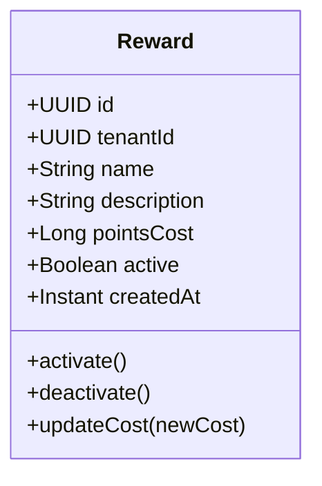
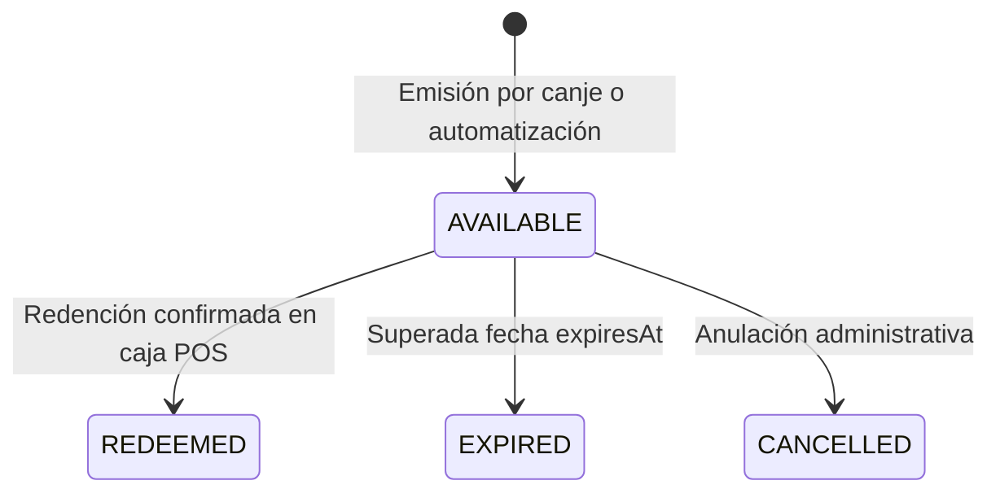

# Recompensas y Cupones

El módulo de recompensas transforma los puntos acumulados por los clientes en beneficios tangibles aplicables en el punto de venta.

---

## 1. Catálogo de Recompensas (`Reward`)

Representa los premios o descuentos que el comercio ofrece en su programa.

- `pointsCost`: Cantidad de puntos necesarios para canjear la recompensa.
- Si una recompensa tiene `active = false`, no puede ser canjeada ni asignada por el motor de automatizaciones.

---

## 2. Cupones de Descuento (`Coupon`)

Representa un cupón emitido para un cliente específico, identificable por un código único para redención en el POS.

### Atributos Clave
- `code` (`VARCHAR(64)`): Código alfanumérico generado unívocamente (ej. `DESC15-9AF2B`).
  - Restricción: `UNIQUE(tenant_id, code)`.
- `discountType`: `PERCENTAGE` (porcentaje sobre la venta) o `FIXED_AMOUNT` (descuento monetario fijo).
- `discountValue`: Valor del descuento (ej. `15.00` para 15% o `$2000.00`).
- `expiresAt`: Marca de tiempo opcional de caducidad.
- `redeemedAt`: Marca de tiempo en que el cajero aplicó el cupón.

---

## 3. Protocolo de Validación y Canje en Caja

El cajero en Kioskito o en el POS interactúa con dos endpoints atómicos:

1. **Validación (`POST /api/v1/coupons/validate`)**:
   - Envía el código ingresado por el cliente.
   - El sistema comprueba:
     - Que el cupón exista en el tenant correspondiente.
     - Que su estado sea `AVAILABLE`.
     - Que la fecha actual sea menor a `expiresAt`.
   - Devuelve `isValid: true` y el detalle del descuento para que el POS calcule el total antes de cobrar.
2. **Canje (`POST /api/v1/coupons/redeem`)**:
   - Al confirmar el cobro, el POS envía el código junto con el `transactionReference` del ticket.
   - La base de datos pasa el cupón a estado `REDEEMED` atómicamente.
   - Cualquier intento posterior de reutilizar el cupón es rechazado inmediatamente con `HTTP 409 Conflict`.
