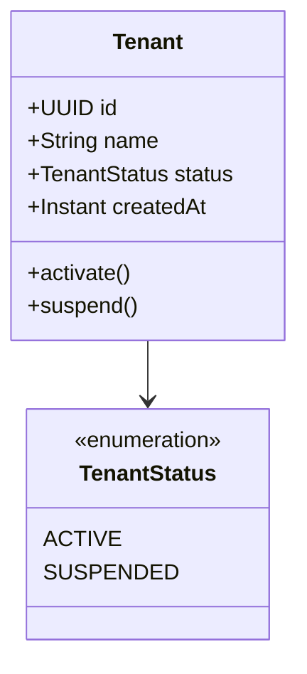

# Tenants e Integraciones POS

Este módulo gobierna la arquitectura multi-inquilino (multi-tenant) y la conexión segura con sistemas de punto de venta.

---

## 1. Entidad: Tenant

Representa la empresa o comercio que contrata la plataforma. Todos los datos de clientes, compras y puntos pertenecen estrictamente a un `tenant_id`.



### Invariantes de Negocio
- Ningún comercio puede consultar ni modificar datos de otro comercio.
- Un tenant en estado `SUSPENDED` no procesa nuevas acreditaciones ni permite canje de cupones.

---

## 2. Entidad: PosIntegration

Representa la conexión M2M configurada entre un tenant y un sistema POS específico (ej. Kioskito).

### Atributos y Mapeo
- `id` (`UUID`): Identificador interno.
- `tenantId` (`UUID`): Tenant al que pertenece.
- `provider` (`String`): Identificador del proveedor (ej. `"kioskito"`).
- `externalStoreId` (`String`): Identificador de la sucursal o local en el POS.
- `apiKeyHash` (`String`): Hash SHA-256 de la API Key suministrada para autenticar llamadas entrantes.
- `encryptedCredentials` (`String`): Credenciales cifradas en reposo para emitir llamadas salientes al POS.
- `status` (`IntegrationStatus`): `ACTIVE`, `DISCONNECTED`, `ERROR`.
- `createdAt` (`Instant`).

**Restricción de unicidad**:
```sql
UNIQUE (provider, external_store_id)
```

---

## 3. Entidad: ExternalCustomerReference

Permite desacoplar el identificador que utiliza el POS (que puede ser un número entero, un código alfanumérico o un documento) del UUID interno del cliente.

```sql
CREATE TABLE external_customer_references (
    id UUID PRIMARY KEY,
    customer_id UUID NOT NULL REFERENCES customers(id),
    integration_id UUID NOT NULL REFERENCES pos_integrations(id),
    external_id VARCHAR(128) NOT NULL,
    created_at TIMESTAMPTZ NOT NULL,
    CONSTRAINT uq_ext_cust_ref UNIQUE (integration_id, external_id)
);
```

### Ventajas de este desacoplamiento:
1. Si el comercio cambia de sistema POS, los clientes y sus saldos de puntos no se pierden ni se corrompen.
2. Si un cliente compra en dos terminales o integraciones distintas, pueden enlazarse al mismo perfil canónico de cliente.
