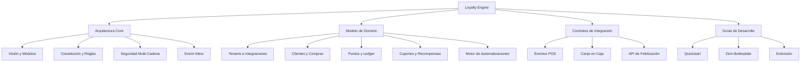

# Loyalty Engine

Plataforma SaaS de fidelización y automatización de clientes para comercios minoristas, diseñada para integrarse con sistemas de punto de venta (POS) mediante contratos estandarizados y adaptadores canónicos.

---

## Quick Path

1. **Revisar la Arquitectura**: Consultá los principios y la estructura en [Visión y Arquitectura](architecture/overview.md).
2. **Entender el Modelo de Dominio**: Explorá las entidades en [Resumen del Modelo](domain/overview.md) y el libro mayor inmutable en [Programas de Puntos y Ledger](domain/loyalty-ledger.md).
3. **Probar el Flujo End-to-End**: Ejecutá los escenarios con `curl` en [Validación Rápida (Quickstart)](guides/quickstart.md).
4. **Respetar los Estándares de Código**: Seguí las reglas de Java 17 y Spring Boot 3 en [Estándares Zero-Boilerplate](guides/zero-boilerplate.md).
5. **Extender el Motor**: Creá nuevos adaptadores de POS y disparadores de automatización con la [Guía de Extensión](guides/extending.md).

---

## Pilares Fundamentales

| Pilar | Decisión Clave | Beneficio Directo |
|---|---|---|
| **Agnóstico al POS** | Modelo Canónico interno con adaptadores de normalización (puerto `PosNormalizationAdapter`). | Los cambios o particularidades de Kioskito o futuros POS no afectan la lógica de fidelización ni la base de datos. |
| **Ingesta Asíncrona Confiable** | Bandeja de entrada `IntegrationEvent` con respuesta HTTP 202 inmediata y deduplicación estricta. | Los eventos responden en <500ms; tolerancia a fallos y reintentos sin riesgo de doble procesamiento. |
| **Libro Mayor Inmutable** | Transacciones de puntos append-only (`EARN`, `REDEEM`, `REVERSAL`) y piso de saldo cero. | Auditoría financiera completa; balance matemáticamente verificable y sin estados negativos. |
| **Zero-Boilerplate Java 17** | `record` para todos los DTOs, validaciones declarativas Jakarta y entidades ricas con `@Getter` único. | Código conciso, seguro en hilos, sin `NullPointerException` ni fugas de modelo hacia la web. |
| **Seguridad Multi-Cadena** | 3 filter chains ordenadas en Spring Security 6 con respuesta HTTP 401 para REST (cero redirecciones HTML). | Aislamiento estricto por comercio (`tenantId`) y desacoplamiento total entre transporte y servicios de negocio. |

---

## Mapa de Documentación

